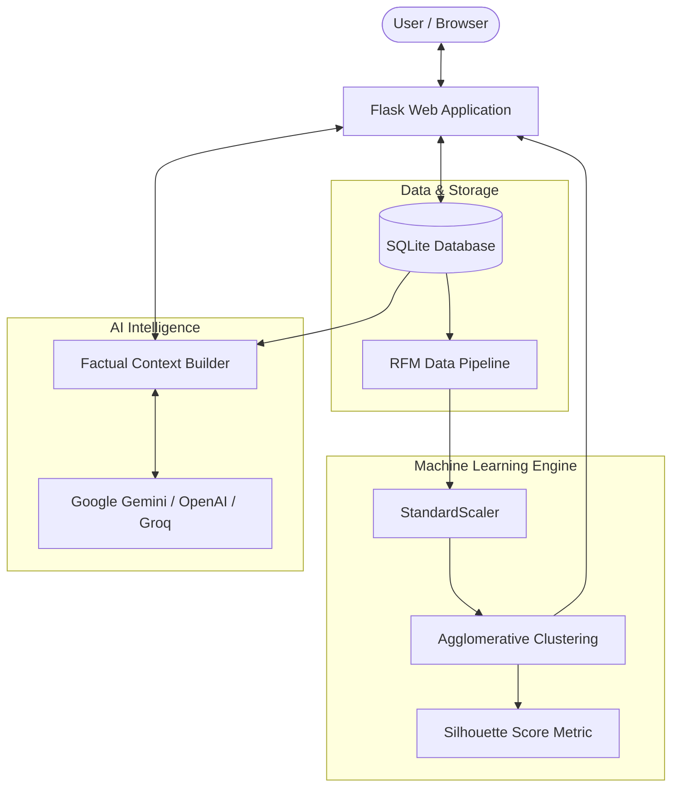

# IntelliSegment 📊🤖

[](https://www.python.org/)
[](https://flask.palletsprojects.com/)
[](https://scikit-learn.org/)
[](https://opensource.org/licenses/MIT)

> **IntelliSegment** is an end-to-end Customer Intelligence and Behavioral Segmentation platform. It pairs statistical **RFM (Recency, Frequency, Monetary) modeling** and **Hierarchical Agglomerative Clustering** with a **Generative AI Business Intelligence Assistant** to deliver actionable insights, churn risk predictions, and financial dossiers.

---

## 🌟 Key Features

- **RFM Feature Engineering**: Computes Recency (days since last purchase), Frequency (total transaction count), and Monetary (cumulative spending) metrics in real-time from purchase logs.
- **Hierarchical Agglomerative Clustering**: Applies unsupervised machine learning (`ward` linkage with standard feature scaling) to automatically categorize audiences into actionable business tiers (*High-Value Champions*, *Moderate / Regular Customers*, *At-Risk / Low-Value Customers*).
- **Silhouette Score Evaluation**: Continuously assesses mathematical cluster cohesion and separation quality, reporting real-time model health.
- **Executive Analytics Dashboard**: Modern Chart.js data visualizations showcasing customer proportions, revenue distribution, and core KPIs (*Total Customers*, *Total Revenue*, *Total Orders*, *Average Order Value*).
- **Customer Dossiers & Churn Risk Engine**: Individual customer profiles featuring lifetime spending, activity status, order frequency patterns, and heuristic churn probability scores (0–100%) with retention recommendations.
- **Descending Sequential Ledger**: Customer directory and segmentation views strictly ordered by sequential ID in descending order (`ID DESC`) so newly created profiles always appear at the top.
- **Printable Invoices & PDF Export**: Generates professional, clean invoices for customer transactions formatted for direct printing or saving as PDF.
- **1-Click CSV Exports**: Instant one-click CSV downloads for both the full customer directory and the enriched segmentation clusters.
- **AI Business Intelligence Advisor**: Embedded LLM assistant powered by Google Gemini, OpenAI, or Groq Cloud, grounded on live database facts with zero hallucination constraints.

---

## 🏗️ System Architecture



---

## 📁 Project Structure

```text
IntelliSegment/
├── ai/
│   ├── assistant.py          # LLM API orchestrator (Gemini, OpenAI, Groq)
│   ├── data_tools.py          # Safe database context extractors & churn evaluator
│   └── prompts.py             # System guardrails, ML domain knowledge & prompts
├── data/
│   └── app.db                 # SQLite database (auto-generated on startup)
├── ml/
│   ├── clustering.py          # StandardScaler & Hierarchical Agglomerative Clustering
│   ├── rfm.py                 # RFM metrics computation from transactions
│   └── segmentation.py        # Dynamic cluster-to-business-label mapper
├── static/
│   └── css/
│       └── style.css          # Custom interface styling
├── templates/
│   ├── add_customer.html      # Add customer form with strict validation
│   ├── add_transaction.html   # Log transaction form
│   ├── assistant.html         # Interactive AI chat interface
│   ├── base.html              # Layout scaffold with Bootstrap 5 & Bootstrap Icons
│   ├── customer_details.html  # Comprehensive customer dossier & churn analysis
│   ├── customer_invoice.html  # Printable / PDF invoice template
│   ├── customers.html         # Customer directory with search & CSV export
│   ├── dashboard.html         # Executive KPIs & interactive Chart.js graphs
│   ├── edit_customer.html     # Customer profile editor
│   ├── error.html             # Error handling pages (400, 404, 500)
│   └── segmentation.html      # Segment breakdown table, summary cards & CSV export
├── .env.example               # Template for environment configuration
├── .gitignore                 # Protected keys and database exclusions
├── app.py                     # Main Flask application entrypoint & routing
├── database.py                # Database connection, schemas, and queries
├── LICENSE                    # MIT License
├── README.md                  # Project documentation
├── requirements.txt           # Project dependencies
└── seed_customers.py          # Realistic sample dataset seeding utility
```

---

## 🚀 Quickstart Guide

### 1. Prerequisites
- Python 3.10 or higher
- Git

### 2. Clone the Repository
```bash
git clone https://github.com/Arnavjain0805/IntelliSegment.git
cd IntelliSegment
```

### 3. Create and Activate a Virtual Environment
```bash
# Windows
python -m venv venv
venv\Scripts\activate

# macOS / Linux
python3 -m venv venv
source venv/bin/activate
```

### 4. Install Dependencies
```bash
pip install -r requirements.txt
```

### 5. Configure Environment Variables
Copy `.env.example` to `.env`:
```bash
cp .env.example .env
```
Open `.env` and configure your API keys (optional, required only for the AI Assistant):
```env
SECRET_KEY=your_secret_key_here
GEMINI_API_KEY=your_gemini_api_key_here
```

### 6. Seed Sample Data (Optional)
To populate the database with realistic customer profiles and purchase transactions:
```bash
python seed_customers.py
```

### 7. Run the Application
```bash
python app.py
```
Open your browser and navigate to:
```
http://127.0.0.1:5000
```

---

## 📊 Business Segments & Methodology

| Segment Name | Typical Spending | Frequency | Recency | Actionable Strategy |
| :--- | :--- | :--- | :--- | :--- |
| **High-Value Champions** | Highest ($4,000+) | Frequent (3+ orders) | High (within 14 days) | VIP rewards, dedicated support & early product access. |
| **Moderate / Regular Customers** | Mid-Tier ($500–$2,000) | Recurring (2–4 orders) | Moderate | Cross-selling campaigns & personalized product recommendations. |
| **At-Risk / Low-Value Customers** | Lower (< $500) | Low (1–2 orders) | Stale (> 30 days) | Win-back promotions, re-engagement offers & feedback surveys. |

---

## 🔗 Key API & Route Directory

| Route | Method | Description |
| :--- | :--- | :--- |
| `/` | `GET` | Executive Analytics Dashboard with KPIs and Chart.js graphs |
| `/customers` | `GET` | Customer Directory with live search and descending ID order |
| `/customers/add` | `GET`, `POST` | Add a new customer profile with validation |
| `/customers/<id>` | `GET` | Customer Dossier, churn evaluation, and order history |
| `/customers/<id>/invoice` | `GET` | Printable / PDF financial invoice |
| `/customers/export` | `GET` | Download full customer directory as CSV |
| `/segmentation` | `GET` | Machine learning segmentation analysis & distribution table |
| `/segmentation/export` | `GET` | Download ML behavioral clusters as CSV |
| `/assistant` | `GET` | AI Business Intelligence Assistant chat UI |
| `/api/chat` | `POST` | Generative AI chat endpoint |

---

## 📄 License

This project is licensed under the **MIT License** — see the [LICENSE](LICENSE) file for details.

---

## 👤 Author

Developed by **[Arnav Jain](https://github.com/Arnavjain0805)**.

